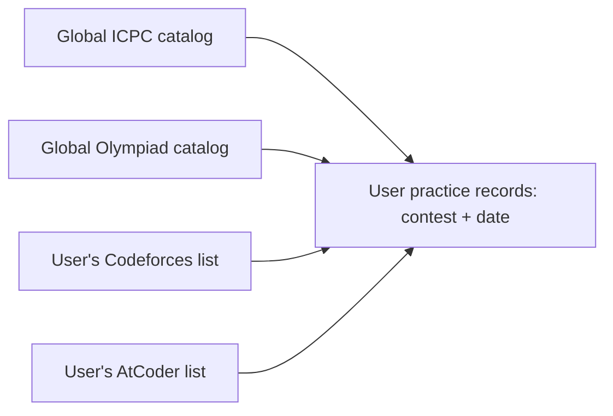
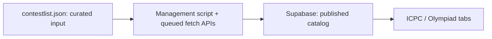

# Initial application model

Date: 2026-10-08 (Asia/Seoul)  
Status: initial tab roles and first account persistence implemented. See
[user data](user-data.md) for current formats and access behavior.

Use the [basic problem and contest model](data-spec-proposal.md) for the initial
implementation and evolve it incrementally.

## Current display implementation

Following the user's instruction to keep `contestlist.json` minimal and use it
just for display, the initial local catalog uses the same small fixtures:

- `problemlists/contestlist.json`: three sample contests with selected problem
  memberships and resource descriptors, using the basic contest record shape.
- `problemlists/problems.json`: four shared problem records. Contest labels are
  stored only in the contest entries, including A/W for the same problem.

The UI directly migrates the corresponding frontend components from
`cloudflare` (source commit `052e590`): the original navigation and layout,
resizable sidebar, tree visibility controls and counts, Year/Problems grids,
and contest/problem panels with icon links. The retained styles and six icons
come from that branch;
AtCoder uses its favicon in the same judge-link component. Roboto is served
locally with the original weights. The earlier replacement layout was removed.

The data adapter builds the prototype's tree from `contest.category` and
resolves each contest membership to a shared problem. It reads the visible
label from the membership's `index`, without putting a label on the problem
record. Folder expansion and visibility choices are held in memory for each
tab. Signed-in choices are persisted; guest choices reset on reload.

The latest frontend pass adds **Platforms** and **Practice Records**:

- Platforms groups the personal collections into Codeforces and AtCoder
  folders, retaining the prototype's tree, grouped grid, import form, and
  dropdown components. Imports use the existing queue through the preview's
  same-origin `api/enqueue/fetch/{cf|atcoder}/contest` and `api/job/result` routes.
- Contest details expose statement materials as links, using the prototype's
  statement icon. Codeforces' published complete problemset page opens all of
  that contest's statements; individual judge links open one problem. The
  minimal frontend does not embed fetched statement HTML. Announcements use a
  general site icon, separate from the statement and editorial icons.
- Fetch materials with `scope: "contest"` enter the contest's material list.
  AtCoder details expose an "Editorial index" link to the contest's editorial
  listing. Admin discovery attaches individual A/B/C statement and editorial
  links to `problemMaterials` after matching their `problemKey` to a shared
  problem. Overall-editorial articles keep contest scope.
- Imported responses are mapped to the basic contest/problem model. Platform
  membership is separate from `contest.category`; newly imported rounds have
  `category: null`. Matching known judge URLs reuses shared identities and
  preserves curated records. The existing global fixtures remain deliberately
  small when a known contest is attached to a platform list.
- Adding a platform round does not create a practice record. **Save Practice
  Record** opens the original date form with that contest selected. The practice
  page also provides a selector across the global and personal collections.
- Records use the prototype's timeline, dated cards, individual problem-label
  headers, and contest/problem details. Dates are plain calendar dates, sorted
  newest first, without converting their display through a timezone.
- The frontend holds `{id, contestId, date}` records in memory while rendering.
  Signed-in rounds, records, status, and preferences are restored from the
  database, as defined in [user data](user-data.md). The API queue persists only
  jobs and source metadata.
- The ordinary prototype form's single-record-per-contest guard is retained.
  Repeated-session policy remains a later decision. Deleting a practice record
  keeps its round and list membership. Canceling an import stops client polling
  and discards its eventual UI result, while the metadata job may still finish.

The following sections describe the broader agreed direction and future
management proposals. Accounts and public-round ingestion are integrated;
curated publication tooling remains later work. See [running the frontend](../README.md).

The [global catalog storage mapping](catalog-storage.md) now has local SQL
JSON read/write adapters. They preserve the frontend's JSON shapes, use stable
UUIDs for references, and keep ordered memberships/materials in their existing
tables. The frontend now reads native catalog JSON from the application gateway;
signed-in user state is restored from Supabase.

## 1. Tab roles

| Tab | Managed by | Content |
|---|---|---|
| ICPC | Global catalog management | Predetermined contests and their problems |
| Olympiad | Global catalog management | Predetermined contests and their problems |
| Platforms → Codeforces | Each user manages their list | Contests the user chooses to add |
| Platforms → AtCoder | Each user manages their list | Contests the user chooses to add |
| Practice Records | Each user | A contest chosen from any collection, with a practice date |

ICPC and Olympiad share curated entity data across users. Personal preferences
and progress are separate from that globally managed content. A curated ICPC
contest can have CF or QOJ judge links; its tab placement is determined by catalog
management rather than the domain of a judge URL.

Each user's Codeforces and AtCoder lists describe their own selections. A user's
addition establishes membership in their list. Curators control membership in
the predetermined ICPC/Olympiad catalog. The storage and publication policy for
the fetched contents of user-added contests remains a separate decision.



## 2. Flow and data relationships

### Globally managed contests

Global management prepares the contest, its ordered problem entries, shared
problem records, categories, and materials. Users browse the predetermined ICPC
or Olympiad collections and can select a contest for a practice record.

#### Management workflow

The [admin page](admin.md) implements link-based queued discovery, review,
publication, shared problem editing, and removal/restoration of global placement.
An admin can begin with statement, editorial, standings, or judge links; the
system derives available metadata and asks for missing information in review.
Existing catalog rows have a grouped editable grid and per-admin drafts saved
on the server. Selected rows can be fetched, reviewed, and published together.
The detailed problem/material editor opens beside the grid. New additions still
use the individual link form; spreadsheet import is not implemented.
Details saves private drafts; a single review-and-publish flow handles batches.
Published refresh choices and manual overrides persist alongside catalog rows,
with the same public problem/contest JSON shape.

1. A maintainer chooses the event, edition, category placement, judge URLs, and
   known official/resource links. This defines which contests enter the catalog.
2. Use the existing queued fetch APIs to collect source information. Inspect
   completeness and verify problem associations across judges.
3. Prepare the basic contest, shared problems, ordered memberships, categories,
   and material descriptors. Correct labels or titles as needed. Keep existing
   IDs when editing known records.
4. After explicit review, a trusted server operation writes and publishes the
   related records in a transaction. Each row in a batch publishes independently;
   stale or invalid rows remain available for correction. Unpublished drafts are
   stored privately and have not changed the published catalog.
5. Users read the published catalog in ICPC/Olympiad and reference its contest
   IDs from their own practice records.

Supabase is the runtime source for the published catalog. Local management files
are inputs for preparing changes. The relevant existing structural tables are:

| Data | Foundation tables/provider |
|---|---|
| Category hierarchy and placement | `catalog.categories`, `catalog.category_entries` |
| Contest records | `catalog.contests` |
| Shared problem records | `catalog.problems` |
| Ordered contest problem entries and labels | `catalog.contest_problems` |
| Resource descriptors | `catalog.materials` |
| Archived file metadata and bytes | `archive.objects` and R2 |

Actual business-field mappings, category ordering, file archival, and management
input format will be defined during implementation. The initial entity materials
contain source URLs; fetching those descriptors does not archive file bytes.

The existing foundation grants normal clients read access to published catalog
rows, while trusted server code manages writes and publication. Related categories,
problems, and membership rows must be published coherently so the complete entry
is readable. Users manage their own progress, list membership, and practice
records separately. Corrections to global records preserve their identities;
retirement and deletion policies need to account for existing user references.

Prototype reference: `problemlists/contestlist.json` supplies event/source
information to the Python crawler, which writes contest files and category trees.
The Worker's `process-icpc-job.js` writes contest JSON to R2 and updates
`contestlist.json` and `icpc/contesttree.json`. Its tree updater is specifically
ICPC; the Python crawler has both ICPC and Olympiad category handling.

#### Proposed role for contestlist.json

Keep `contestlist.json` as a version-controlled maintainer input for the curated
ICPC/Olympiad catalog. It describes the contests to prepare and their curated
metadata. Supabase holds the assembled, published records read by the app.
Personal Codeforces/AtCoder selections and practice dates are user records in
the database.

Use the existing basic contest field names for the management input. A proposed
entry is the following subset of the full contest record; UUID and URLs are
illustrative values reused from the model example:

```json
[
    {
        "id": "a5f49e87-8b37-4cc8-aa16-565878777419",
        "title": "The 2023 ICPC World Finals Luxor",
        "year": "2023",
        "category": ["ICPC", "World Finals"],
        "link": {
            "cf": "https://codeforces.com/gym/105255",
            "qoj": "https://qoj.ac/contest/1662",
            "atcoder": null,
            "official": "https://icpc.global/community/results-2023",
            "standings": "https://clist.by/standings/47th-annual-icpc-world-finals-luxor-egypt-50284536/?timeline="
        }
    }
]
```

- Generate a contest UUID once when adding its input entry, and retain it in
  the file. Editing the title, links, or category path preserves that identity.
- The file supplies curated `title`, `year`, `category`, and `link` values.
  Fetch responses supply candidates for problems and material descriptors;
  fetching does not overwrite a curated title with a judge's different title.
- The initial root category is ICPC or Olympiad. The importer can build populated
  category paths and contest placement from these arrays. Empty directories and
  category ordering need a separate definition.
- Full problem records, ordered memberships, and discovered materials are
  assembled during preparation. Verified cross-judge associations and optional
  manual overrides need a defined input/ingestion format before implementation.
- Apply changes by stable ID so repeated imports update known records and reuse
  known problem identities. Failed or incomplete collection keeps the previous
  published data until a complete or deliberately curated update is prepared.
- Use one transaction for each coherent catalog update. The initial tool should
  support additions and updates; retirement of missing entries needs an explicit
  policy accounting for users' existing practice references.



This preserves the prototype's maintainable input list while removing runtime
dependence on per-contest JSON directories. File archival through R2 is a later
operation; material URLs can be published before files are archived. The manifest
format and importer described here are proposals. A small static display catalog
has been created for the current frontend; this importer has not been implemented.

### User-added contests

1. The user chooses a contest in a Codeforces or AtCoder collection under Platforms.
2. The existing fetch service obtains its source information.
3. The authenticated ingestion step turns that information into the basic contest and
   problem records and attaches the contest to this user's list.
4. The user can subsequently select it for a practice record and choose a date.

Adding a contest to a personal list and adding a dated practice record are two
separate actions. A contest can be in the user's list before they record any
practice.

### Practice records

A practice record associates the current user with an existing contest and the
date the user selects. Its contest may come from either global tab or any
personal collection under Platforms. The practice date describes the user's activity, independently
of the original contest's year or scheduled start time.

Use the same contest identity across its tab and the practice record. Reuse the
referenced problem records and contest memberships. Problem data consists of
`id`, `title`, and `link`; the contest's problem entry carries `index`.

The contest record describes the event and problems. The user's list membership
describes which contests they added. A practice record describes a dated activity.
The current fields and database mappings are defined in [user data](user-data.md).

## 3. Comparison with the cloudflare prototype

These findings come from reading the prototype branch, not running its frontend.

| Feature | Prototype | Agreed initial direction |
|---|---|---|
| Global ICPC/Olympiad browsing | Shared contest JSON and category trees loaded from Worker/R2 | Predetermined, globally managed catalogs |
| Codeforces collection | Import form inside Practice Records | Personal Codeforces collection under Platforms |
| AtCoder collection | No AtCoder tab or import flow | Personal AtCoder collection under Platforms |
| Adding an imported contest | CF/QOJ/BOJ import also creates a dated practice record | Add to a judge list, then select it for practice |
| Practice from a catalog contest | Save Practice Record opens a date form for that contest | Any global or personal contest collection can supply the contest |
| Practice persistence | Per-user contest reference, date, and sorting timestamp | Owner/contest reference and validated date, one record per user/contest |
| Imported contest persistence | Full contest copies in per-user `userCodeforcesContests`, also used for QOJ/BOJ | Shared basic metadata plus private list membership in Supabase |

Relevant prototype code:

- `cloudflare:src/constants.js:24`: navigation has Home, ICPC, Olympiad, and
  Practice Records.
- `cloudflare:src/ui.js:271`: fetches the common contest list and contest JSON.
  `src/ui.js:311` loads category trees.
- `cloudflare:src/contest.js:122`: Save Practice Record passes the selected
  contest to the practice date form.
- `cloudflare:src/practiceRecords.js:16`: CF/QOJ/BOJ import menu inside Practice
  Records. `src/practiceRecords.js:106` contains the contest/date form.
- `cloudflare:src/practiceRecords.js:685`, `:957`, and `:1203`: import functions
  persist a contest and create a practice record.
- `cloudflare:src/state.js:325`: a practice record holds `contestId`, `date`,
  and a timestamp derived from that date.
- `cloudflare:src/auth.js:314`: saves user data to the authenticated user's
  Firestore document.

The checked-in Olympiad tree has category directories but no contest leaves.
The shared browsing structure exists; its population is a separate task.

## 4. Consequences and open details

The personal judge lists give contests a lifetime independent of practice
records. Deleting a practice record keeps the contest in its judge list; this
is implemented in the current in-memory frontend. This differs from the prototype, where deleting the
last practice record for a Codeforces import removes that saved contest copy
(`cloudflare:src/state.js:348`). Detailed removal operations remain to be designed.

Open details:

- **Repeated practice:** `cloudflare:src/practiceRecords.js:140` rejects a duplicate contest
  in the ordinary Save Record form, even on another date. The import functions
  call `addPracticeRecord()` directly, which generates a new record ID without
  that check. The current frontend keeps the ordinary form's guard; a broader
  first version enforces one practice record per user/contest in the database.
- **Progress in practice records:** the prototype shows current overall problem
  progress in both checklist and practice views (`src/practiceRecords.js:196`).
  Per-session results or historical snapshots have not been specified.
- **Removal from a personal list:** existing practice records keep their contest
  reference; removing a selection does not delete shared metadata.
- **User-added metadata:** verified public CF/AtCoder metadata is shared, while
  selections and all user records are private. Canonical judge URLs and atomic
  ingestion reuse identities across users. Cross-judge equivalence remains an
  explicit catalog decision.

The storage foundation and basic catalog mapping have catalog, saved-contest,
and practice-session boundaries. Email/password accounts, source ingestion,
owner-isolated persistence, and prototype status controls now work through the
application gateway. Personal difficulty and per-session outcomes remain later work.
