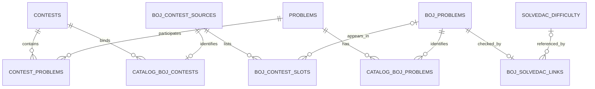

# BOJ and solved.ac database integration

Status · PostgreSQL persistence, reviewed publication, and the difficulty read
path are implemented for `beta` and migrated on local Supabase. The adoption
comparison was read-only. Seoul Regional 2024 is the first BOJ adoption in
the local catalog. Live app-authenticated solved.ac verification and hosted
deployment are pending.

Use the existing catalog UUID as the identity of a task in PS Checklist. Use
BOJ as the first source for the title and problem link of a verified whole-task
match. Use solved.ac as the source of its own difficulty measures. An
organizer task, a BOJ judge entry, and a solved.ac rating can have different
identities.

## Current database and write path

- A read-only query against the local Supabase database returned 1,046
  published contests, 6,139 published problems, and 6,188 published
  memberships. Forty-five problem UUIDs are used in more than one contest.
  The published problem records had CF, QOJ, AtCoder, and oj.uz links, with
  zero BOJ links. The statement-variant table had zero published rows.
- `catalog.problems` stores the shared UUID and display metadata.
  `catalog.contest_problems` stores ordered memberships with a UUID, position,
  string label, and optional group. Progress, votes, and notes point to the
  problem UUID. A practice attempt can also point to the membership UUID.
  A catalog merge or lineup rewrite can therefore affect user records.
  [Storage foundation](../supabase/migrations/20261006000000_storage_foundation.sql)
- The admin flow fetches into a draft, resolves identities, and publishes under
  expected-version checks. `storage/problem_merge.py` can merge judge entries
  by unique titles within a contest. The initial BOJ integration should make
  such matches suggestions requiring review. `storage/admin.py` currently
  derives completeness from the number of returned references. A BOJ result
  can satisfy that count check while carrying an unresolved slot, so preserve
  the crawler's slot and partial-result information in the draft.
  [Admin workflow](admin.md#fetch-review-and-publish)
- `GET /api/problem/difficulty` currently returns the community vote count,
  average, and caller's vote. Both preview and the hosted Worker read these
  through the same SQL function. The crawler's solved.ac caches live in
  memory. The crawler jobs and their result objects have their own retention.
  [Deployed API contract](deployment.md#api-and-ownership)

## PostgreSQL model

Add versioned SQL migrations. Keep source rows and verification evidence under
`app_private`, with approved fields read through narrow catalog and difficulty
projections.

| Table | Identity and purpose |
| --- | --- |
| `boj_problems` | Positive BOJ global `problem_id` as primary key. Store the observed title, availability, task mode, permitted metadata such as limits and source flags, relevant license evidence, and fetch timestamps. Generate the canonical URL from the ID. A verified linked slot can create a stub before the problem page is fetched. |
| `boj_contest_sources` | BOJ source-detail `source_id` as primary key. Store the requested identity, final fetched URL and parent category if available, title, and observed completeness. Keep the most recent subject-page fetch time and last complete fetch time. |
| `boj_contest_slots` | Primary key `(source_id, position)`. Keep the native label as text, displayed BOJ number, and a nullable FK to `boj_problems`. The displayed number is retained even when the slot has no usable link. The optional linked ID must agree with the displayed number. |
| `catalog_boj_contests` | Approved binding from a verified BOJ detail ID to a catalog contest UUID or a specific group within it. In the first release allow one binding per curated contest or group and one owning curated scope per BOJ detail ID. Validate group membership under the same catalog version check because groups are embedded in JSON. |
| `catalog_boj_problems` | Approved relation `(catalog_problem_id, boj_problem_id)` with kind `equivalent` or `part`, evidence, reviewer, and verification time. A BOJ native ID can be equivalent to at most one catalog UUID. Allow a single preferred whole-task equivalent per catalog UUID and ordered, individually linked parts. Retain BOJ labels in native slots, where they can differ by contest. |
| `solvedac_difficulty` | Provider key `(provider_problem_id, sub_id)`, using the empty string for the base problem. Keep the latest validated snapshot and its provider fetch time. Store the level and allowlisted aggregate measures and eligibility flags. |
| `boj_solvedac_links` | One lookup state per BOJ native ID, with a nullable FK to the provider key. Many BOJ rows may reference one provider record. Keep the last verified association, last check outcome, evidence for the exact judge reference, and time of the next eligible lookup. |

Use foreign keys, uniqueness constraints, and indexes in SQL for both directions
of problem and provider lookups. Keep a native slot independent of a catalog
membership. Its contextual label can be read by combining the approved
contest or group binding with its slots and the approved problem relation.
Surface ambiguous contextual associations for admin review. The first release
stores current observations and reviewed evidence. Add historical snapshots
only if a later feature needs them.



Derive optional `link.boj` from approved bindings when reading existing
catalog JSON. Return ordered part links separately from the whole-task link.
A parent `/category/{id}` can be a discovery reference. The approved contest
binding uses `/category/detail/{id}` even when it redirects. Use one
authoritative copy of each binding. Validate BOJ inputs in the Python, browser,
and SQL form paths. Strip or validate derived fields before passing records
through the existing strict JSON write functions, including personal imports
that reuse shared catalog objects.

## BOJ adoption and publication

1. **Fetch and stage.** Start from explicitly chosen contest and group detail
   URLs. Use the crawler's verified table selection and carry the full ordered
   slot list, request locator, completeness, and warnings into the review
   draft. Fetch global problem pages for selected candidates that need
   verification or previously missing metadata. Keep problem observations
   distinct from the contest's curated links and display fields.
2. **Resolve identity.** An exact, previously approved BOJ ID reuses its
   catalog UUID. For a new cross-judge association, require a verified
   equivalent resource, or corroborating contest and task evidence reviewed
   against the existing problem. Titles, translations, labels, and position
   can help find candidates. If evidence conflicts or suggests two existing
   UUIDs claim the same whole task, hold the proposal for review. Reassigning
   user records between UUIDs is a separate operation.
3. **Set source preferences.** For an approved whole-task match, prefer the BOJ
   problem link and feed the BOJ title into the existing field-provenance and
   manual-override rules. Keep contest metadata and **Order and labels from**
   as independent choices. Existing catalog rows retain their order in the
   pilot. A later explicit BOJ lineup choice requires full coverage and
   verified one-to-one alignment. Associate limits, language restrictions, and
   link availability with the judge entry they describe. Keep curated official
   materials and existing judge links available.
4. **Publish atomically.** Extend the existing admin publication transaction
   to write approved BOJ bindings along with any catalog edits. Check
   expected versions and lock BOJ IDs in a consistent order. Reuse the
   hosted agent's lease and write receipts for retries. Validate provenance
   against the trusted fetch result. A failed write leaves the draft
   reviewable. For observations, reject older jobs using the subject-page
   fetch time. Carry that timestamp explicitly when an envelope aggregates
   several pages and uses the earliest timestamp. Repeating the same
   successful observation should be a no-op. Keep group renames and their
   approved source bindings consistent in the same transaction.

A partial BOJ result can enrich verified rows and show missing slots in
review. It preserves the curated count, membership IDs, materials, and last
successful adopted values. An ambiguous division stays unbound until reviewed.
Initially persist BOJ links and descriptive metadata. Require a rights basis
for copying statement HTML, samples, or attachments into PostgreSQL or R2.
[BOJ terms](https://acmicpc.net/terms)

## Solved.ac ingestion and reads

1. Test app-authenticated v4 retrieval before enabling any automated lookup.
   Resolve the BOJ judge namespace from `/api/v4/judges`. Test the documented
   judge-native contest resolver and solved.ac contest detail as a batch
   source of candidate problem records. The spec exposes `judgeIds` on
   returned contest problems. Confirm which BOJ detail IDs the resolver
   accepts. Require an exact BOJ reference in `judgeIds` before accepting
   any association from the contest list.
2. For uncovered IDs, verify the singleton query syntax with
   `/api/v4/search/analyze` and the paginated problem search. Use the exact
   BOJ reference and the returned provider `(problemId, subId)`. Validate
   the detail response against that pair. Verify suffixed IDs, two BOJ IDs
   that share a provider entry, a confirmed miss, and the shape of an
   unrated result. A manually supplied solved.ac URL also needs a verified
   BOJ association before it can attach to a catalog problem.
   [Official v4 OpenAPI](https://backstage.solved.ac/api/v4/openapi)
3. Upsert the provider snapshot once and link each verified BOJ ID to it.
   Retain `level`, `levelAverage`, `levelStdev`, vote counts, `isStandard`,
   `givesNoRating`, and `noRatingReasons` in the normalized projection.
   Preserve the last successful timestamp. An explicit provider level of
   zero means unrated. Use a confirmed negative only after a complete
   accepted lookup. Incomplete contest coverage and upstream errors have
   their own outcomes. Ambiguity or a contradicted association goes to
   review and is excluded from the published rating until verified.
4. Expose a small attributed solved.ac tier, link, and snapshot age in the
   problem panel. Extend the existing difficulty read shape additively
   and preserve its community fields. Return one whole-task rating for the
   preferred verified equivalent. Show available part ratings beside their
   links for split tasks, without synthesizing a rating for the original
   task. Scope public reads to published UUIDs and their approved relations.
   Keep provider exports, diagnostics, and credentials off the public API.
   The developer terms announced for November 24 prohibit services that
   re-serve API data verbatim. Use an attributed feature within the checklist.
   [solved.ac developer terms](https://solved.ac/developer-terms)

Separate the scheduled work by provider and entity. Fetch BOJ on admin
request during the pilot. Schedule solved.ac snapshots only for approved
BOJ IDs, with a unique work key per mapping and per provider snapshot.
Start with 24-hour snapshot freshness, seven-day verification of positive
mappings, and a one-hour minimum cache for confirmed misses. Keep misses
low priority in bounded scheduled batches.
Honor provider rate costs and `Retry-After`, retaining the previous valid
snapshot during transient failures. Pause a provider batch on credential
failure. Run bounded batches through the existing crawler and hosted pull
queue after manual runs are verified. A problem-panel read requires only the
database.

## Read-only pilot and acceptance

Generate a review report keyed by existing contest and problem UUIDs. For
each proposal include the current link, candidate BOJ detail and problem IDs,
native and catalog labels, evidence, coverage outcome, and any field that
would change. Use a small reviewed input manifest for the pilot so the
existing raw CSV and its checksummed fetch receipts can be reused. Add an
optional BOJ CSV column once all readers and batch tools accept the two
existing formats as well as the new one.

| Pilot case | Expected outcome |
| --- | --- |
| Seoul Regional 2024 | Check a full 12-slot match. The existing first task is **A · Bottles** with a QOJ link. Verify its BOJ match before adopting the link on that UUID. [BOJ detail 4348](https://acmicpc.net/category/detail/4348) |
| Luxor 2022 and 2023 | The local catalog already shares one **Riddle of the Sphinx** UUID with labels `W` and `A`. One approved BOJ ID enriches both memberships. Any different judge limits stay with the respective judge. [BOJ 31897](https://acmicpc.net/problem/31897) |
| Baku 2025 | Keep all 12 existing memberships. Native BOJ slot `I` retains the displayed number 34484 and a missing link. Existing **Slot Machine** remains available through QOJ and its organizer document. [BOJ detail 4567](https://acmicpc.net/category/detail/4567) · [QOJ 14609](https://qoj.ac/problem/14609) |
| IOI 2014 Day 2 | Preserve curated `A` Gondola, `B` Friend, `C` Holiday and their organizer documents. Record BOJ's five native slots. Store 10072, 10073, and 10074 as ordered parts under the existing Gondola UUID with native labels `4-1`, `4-2`, and `4-3`. [BOJ category 550](https://acmicpc.net/category/550) · [Organizer Gondola statement](https://ioinformatics.org/files/ioi2014problem4.pdf) |
| KOI 2025 and SNU 2023 | Exercise parent redirects, division scope, and reused native IDs. Confirm KOI's curated divisions. Use SNU as a crawler fixture to verify that a problem can be `B` or `H` in different divisions. [KOI group 1126](https://acmicpc.net/category/1126) · [SNU problem 30181](https://acmicpc.net/problem/30181) |

### Operator workflow

Run the read-only comparison from the repository root. Supply
`--observations` with recorded normalized BOJ contest observations to replay
previous fetches when upstream is rate limiting.

```bash
python3 scripts/plan_boj_adoption.py --output /tmp/boj-adoption.json
```

The first comparison replayed six captured contest pages against the local
catalog. It found 48 title candidates, three Gondola part proposals, three
unmatched slots, and one missing link. Title candidates remain review items.
A test publication in a disposable copy attached BOJ 32829 to the existing
Bottles UUID and preserved all catalog and membership counts.
After the local migration, the public catalog API returned 1,045 curated
contests and 6,133 referenced problems in 0.78 seconds. The local database
contained zero approved BOJ bindings and zero saved solved.ac snapshots.

The first local publication linked all 12 Seoul Regional 2024 tasks and stored
metadata from each BOJ problem page. It checked the BOJ lineup against the
existing QOJ records and official problem set, retaining the contest UUID,
task UUIDs, membership labels, and QOJ links. The source-managed title for
slot B follows BOJ and the organizer's statement heading, **Cards Flipping**.
The organizer's contents page and QOJ use **Card Flipping**. The local crawler
requires solved.ac app credentials before enriching this contest with tiers.
[BOJ detail 4348](https://acmicpc.net/category/detail/4348) · [Official problem set](https://static.icpckorea.net/2024/regional/problemset.pdf)

For an already published contest, open **Contest links → Review BOJ source**.
Fetch a detail URL, select the existing task for each reviewed slot, and enter
the verification evidence. Fill in part order for a split task. Publishing
these links preserves the saved lineup. Problem page metadata can also be
stored with `POST /api/admin/boj/observe` and a completed BOJ problem job ID.
An optional BOJ input in the bulk CSV workflow is a later rollout step.

After the authenticated solved.ac lookup has been verified, run a small
refresh batch. The command reads approved BOJ IDs due for refresh and uses
the existing queue. Use `--hosted .env.deployment` with a running hosted
crawler to select that deployment explicitly.

```bash
python3 scripts/refresh_boj_difficulty.py --limit 10
```

### Rollout order

1. Add BOJ tables and private staging in a forward SQL migration. Test
   against fresh PostgreSQL and a copy with existing catalog data. Run the
   read-only pilot and count exact, reviewed, missing, and conflicting matches.
   Run the hosted migration ledger twice to verify the second run skips the
   applied migration. Verify snapshot export and restore preserve the new
   references.
2. Wire reviewed BOJ bindings into admin publication and the shared catalog
   read model. Regress manual titles, grouped order, partial refreshes,
   old CSVs and drafts, archive references, practice attempts, progress,
   notes, and votes. Test repeated writes, stale results, concurrent
   approvals, and lost hosted acknowledgements.
3. Add solved.ac tables and idempotent refresh writes, then run the bounded
   authenticated checks. Publish the attributed tier projection after
   verifying the mappings and public visibility rules. Check that an
   unpublished UUID, ambiguous mapping, or restricted source row cannot
   expose a provider snapshot.
4. Expand from the pilot in reviewed batches. Measure candidate and approved
   coverage, missing slots, rating age, and unresolved or conflicting
   identities. Disable scheduling or public projection if a rollout needs
   to pause. Keep the existing catalog, fallback links, and reviewed evidence
   available for recovery.
